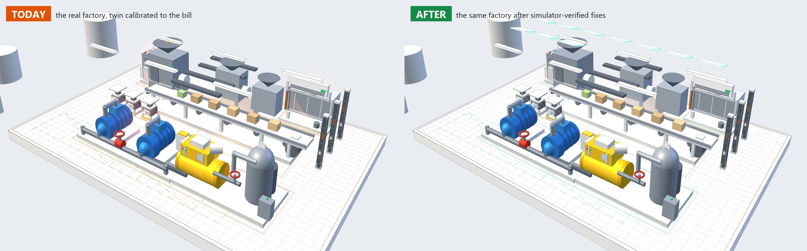
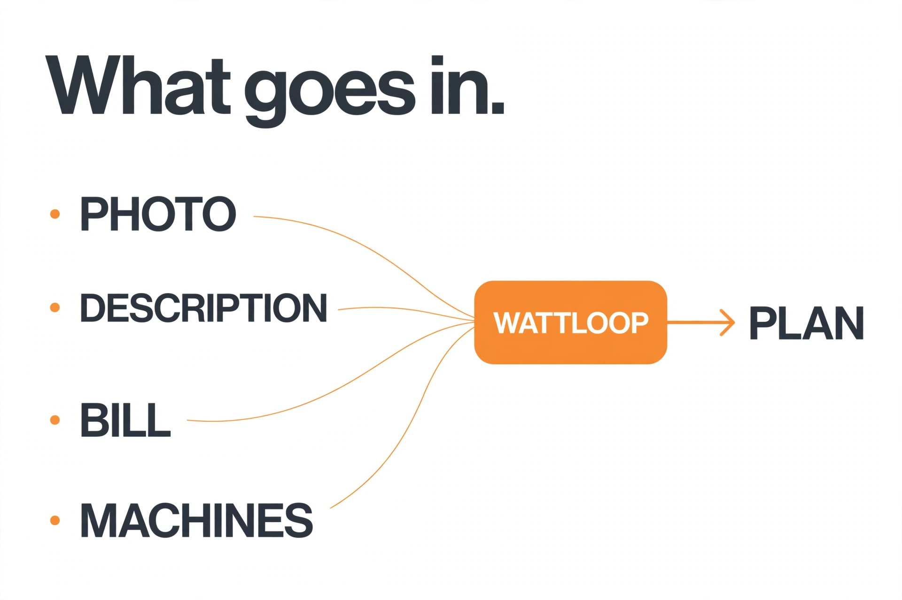
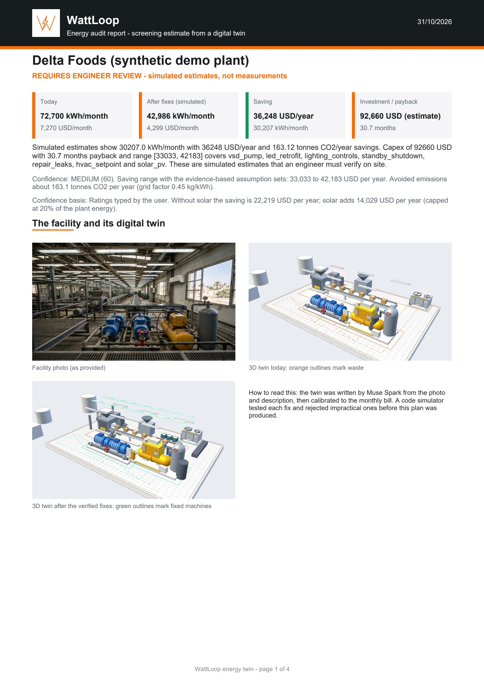
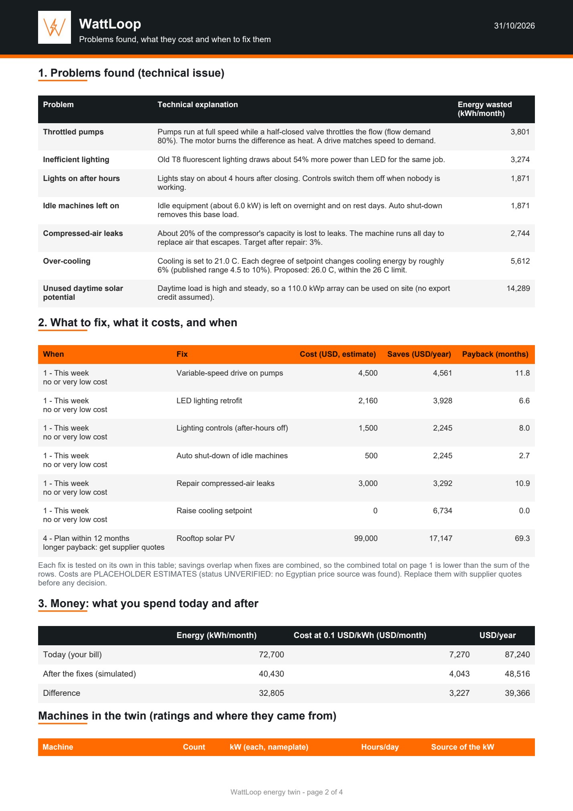
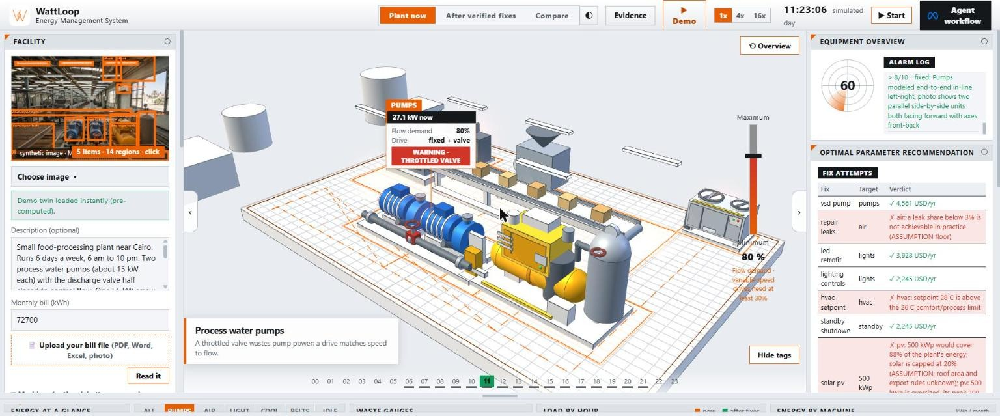
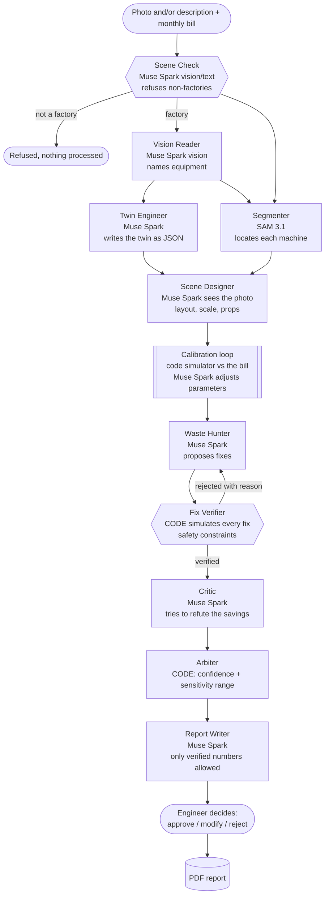
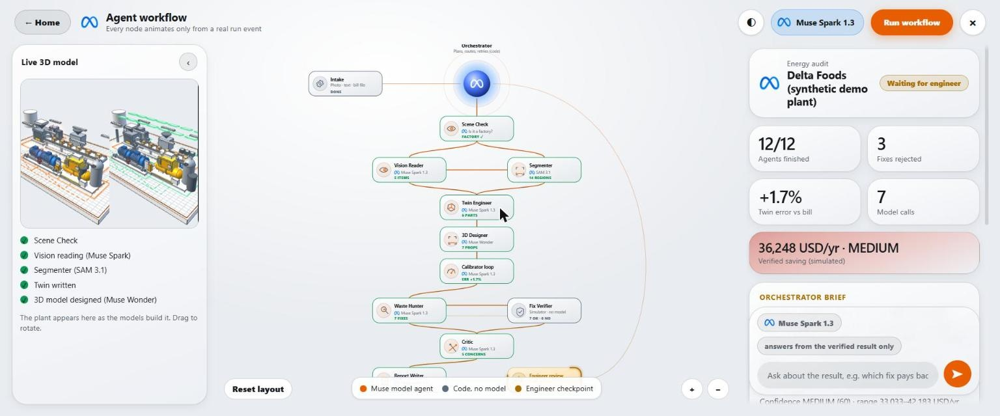

# WattLoop

### An energy audit in minutes, not weeks. Meta models build a living 3D twin of a factory, a simulator proves every fix before money is spent, and an engineer gets a ready report.

Give WattLoop a photo (or a few sentences about the machines) and the monthly electricity bill. It names the equipment, builds a calibrated digital twin, finds the waste, **tests every proposed fix in simulation**, rejects the impractical ones, and hands an engineer a PDF with the problems, the cost, the savings and *when* to fix each one. Nothing is final until the engineer decides.

<p align="center"><br><sub><b>Compare view.</b> Left: the factory as the bill describes it (air leaks, throttled pumps, lights left on). Right: the same factory after the fixes the simulator verified. Same clock, live kW meters.</sub></p>

<p align="center"><br><sub>Logo generated by Muse Image 1.0</sub></p>

## Hackathon track

**Meta Global AI Developer Hackathon, Indie Developer track.** Theme: **Push the Frontier**: software agents that reason about physical systems and energy.

**Why it fits:** Meta models do the reading, designing, proposing and critiquing in a loop; a code simulator checks every number; and an engineer decides. It is an agent system that acts on the physical world, not a chatbot.

---

## The engineer stays in charge

WattLoop is built to **empower engineers, not replace them**. It does the slow first pass (reading the plant, building the twin, testing fixes) so the engineer arrives on site with a ranked, evidence-backed plan instead of a blank page. Every run ends at an engineer decision (approve, modify or reject, with a recorded note), and the final report depends on the engineer's view and analysis of the data. Faster, not unnecessary.

## Why this matters (a global problem)

Industry is the biggest energy user on Earth, and most of its electricity is hidden in motors, pumps, fans and compressed air.

- Industry uses **nearly 40% of the world's final energy** and drove about two-thirds of the growth in energy demand since 2019, while its efficiency gains have slowed to **under 0.5% a year** ([IEA, Energy Efficiency 2025](https://www.iea.org/reports/energy-efficiency-2025/industry)).
- **Electric motor systems use 53% of all electricity worldwide (13,462 TWh) and 72% of industrial electricity (7,740 TWh)** ([IEA 4E, 2023 data](https://www.iea-4e.org/wp-content/uploads/2025/12/4E-Policy-Brief-EMSA-9-20251218.pdf)).
- The IEA estimates **20-30% of motor-system electricity can be saved cost-effectively**, about 10% of all electricity demand ([IEA](https://iea.org/reports/energy-efficiency-policy-opportunities-for-electric-motor-driven-systems)). Compressed-air leaks alone can waste 20-30% of a compressor's output ([US DOE](https://www.energy.gov/sites/prod/files/2014/05/f16/compressed_air3.pdf)).
- The savings are cheap and fast when found: in the US DOE audit database, **56% of 91,551 recommendations pay back in under a year**, yet only about 45-47% get implemented ([ITAC database](https://itac.university/payback)). And **75% of audit clients said they would not have sought an audit without the program**, citing missing service providers, time and budget ([SRI International, 2022](https://iac.university/file/technical/Industrial%20Assessment%20Centers%20Impact%202022%20SRI%20International.pdf)).
- Illustrative arithmetic (not a forecast): saving 11-18% of the 7,740 TWh that motor systems use in industry would be **about 850-1,390 TWh a year**, roughly a third to a half of the EU's annual electricity use.
- **In dollars (same arithmetic, an illustrative $0.10/kWh):** 850-1,390 TWh x $0.10 is **about $85-139 billion a year** in electricity that industry could stop buying. Prices differ by country, so treat it as an order of magnitude, not a forecast.

The gap is not knowledge, it is access: audits take weeks, cost money and need scarce experts, so most small and medium plants never get one. **WattLoop turns the first-pass audit into something any plant, anywhere, can do in minutes**, with every number traceable and every fix tested before it is recommended. It is built to work with any country's tariffs and grid emission factor (the tariff, currency and grid factor are plain inputs; the default is USD).

<p align="center"><br><sub><b>What goes in.</b> A photo or a description, the monthly bill (required) and an optional machine list. The engineer decides on the plan. Graphic generated with Muse Image 1.0.</sub></p>

## Tell it your machines (optional, big accuracy gain)

Pick the machines from a short list (pumps, compressors, fans, conveyors, mixers, lighting, air-conditioning, standby loads), then enter the **count, nameplate kW and hours per day**. Typical kW values are pre-filled in italics as placeholders to replace. Optional facts (HVAC setpoint, hours the lights stay on after closing, compressor control type) sharpen it further. The bill then becomes a **cross-check** instead of the only source of sizes; if your machines cannot explain the bill, the app adds a labelled "unlisted loads" block and lowers its confidence.

A synthetic test (200 random plants where the true saving is known, **not real plants**) shows how much the inputs matter, as the median error of the predicted saving: bill and photo only about 41%, machine list with typical kW about 23%, with the plant's own kW about 18%, with kW plus the facts above about **7.5%**. Reproduce: `python tools/benchmark_inputs.py 1000 200`. The compressor-leak default (20%) follows the US DOE's 20-30% range; the test plants draw leaks from 10-30%, so treat the numbers as a trend, not a promise.

**Solar is shown apart.** Generation is not waste removal, so the result lists the saving *without* solar and what solar adds, with the array capped at 20% of the plant's energy.

## Business value

| For the plant owner | For the energy engineer or consultant | For the country |
|---|---|---|
| Know *where* energy is wasted and *what each fix is worth* before spending | Skip the blank-page work: arrive on site with a calibrated twin and a ranked plan | Lower industrial demand and emissions, in any country |
| Fixes ranked by payback: this week, this month, next quarter | Review, not rebuild: approve, modify or reject with a recorded note | Scales to thousands of small plants that cannot afford an audit today |
| A report the bank, the board or the engineer can act on | A traceable evidence trail for every number | Local tariffs and grid factors are plain inputs |

**Per plant, in dollars:** in the synthetic demo plant the verified plan cuts the bill by about 23,000 of 72,700 kWh a month (about a third), **roughly $27,800 a year**. A real plant's number depends on its own bill and machines.

**How the value is calculated (no magic numbers):** `saving = kWh wasted x tariff`, per fix, from a physics model checked against published measurements. For the synthetic demo plant (72,700 kWh/month) the verified plan saves about **23,000 kWh/month, roughly $27,800 per year** at $0.10/kWh (about the US industrial average, EIA 9.64 cents/kWh in August 2026; set your own price), with a stated range that the report prints. Equipment costs are placeholders to replace with supplier quotes. The plant is synthetic and the equipment costs are placeholders that the report tells you to replace with supplier quotes.

<p align="center"> <br><sub><b>The deliverable.</b> A PDF with the 3D twin today and after the fixes, the problems with a technical explanation, what to fix, what it costs, when to fix it, money today versus after, risks and an engineer sign-off block.</sub></p>

## See it work

<p align="center"><br><sub><b>Click any machine.</b> The view flies in, shows the live power, the waste (a 25% air leak here) and where the parameter sits against its safe range. Dashboard widgets, an accelerated day cycle and hourly load update with it.</sub></p>

- **Different image, different plant:** the layout, proportions and props come from the photo or description.
- **Click the photo** to see exactly what Muse Spark named and what SAM 3.1 located.
- **Fix attempts:** the Waste Hunter proposes aggressive fixes; the verifier rejects impractical ones with a reason; the hunter corrects them.
- **Evidence panel:** every number's source and status, and the formula check against published data.
- Light and dark mode, image gallery, upload, describe-the-machines mode, instant demo, cancel button, collapsible panels.

---

## How the agents collaborate

WattLoop is a **multi-agent system with a code-owned spine**. Meta models do the perception and reasoning; plain code does all arithmetic, verification and routing. No single model call decides anything on its own.



| Agent | Model | Job | Safeguard |
|---|---|---|---|
| Scene Check | Muse Spark (vision / text) | Refuse anything that is not clearly a factory (fruit, furniture, X-ray) | Runs first; nothing else starts if refused |
| Vision Reader | Muse Spark (vision) | Name the equipment and visible waste signs | Output validated, text in photos treated as data |
| Segmenter | SAM 3.1 | Outline each machine in the photo | Falls back to no overlay |
| Twin Engineer | Muse Spark | Write the facility as structured JSON | Clamped to the twin's schema in code |
| Scene Designer | Muse Spark (sees the photo) | Place machines, scale them, add props from the photo | Bounds, spacing and primitive limits enforced; falls back to a layout from the SAM boxes |
| 3D Modeller | Muse Wonder (sees the photo; Muse Spark as fallback) | Designs each machine's shape as 14-30 simple parts (boxes, cylinders, cones, spheres, tori) with positions, sizes and colours | Parts are data, never code: shape, size, position inside the machine's floor slot, colour and part count are validated; falls back to a built-in shape |
| Calibration loop | Code + Muse Spark | Match the twin to the real bill (under 5% error) | Hard cap of 5 iterations; deterministic fallback |
| Waste Hunter | Muse Spark | Propose fixes from a catalog, aggressively first | Every proposal is simulated, never trusted |
| **Fix Verifier** | **Code** | Apply each fix to the twin, reject impractical ones (3% leak floor, 26 C limit, 30% minimum drive speed, solar size cap) | Rejections go back to the hunter with the reason |
| Critic | Muse Spark | Argue against the savings claim | Lowers confidence; adds on-site checks |
| Arbiter | **Code** | Confidence score and a low/base/high savings range | Never takes the model's confidence at its word |
| Report Writer | Muse Spark | Write the engineer's brief | A validator rejects any number not in the verified result |
| Engineer gate | Human | Approve, modify or reject, with a recorded note | The workflow cannot finish without it |

<p align="center"><br><sub><b>The agent workflow, live.</b> Every node lights up from a real run event: models in orange-outlined cards, code-only steps marked "no model". The left panel shows the 3D plant as it is built. When the plan is verified, a decision card asks the engineer to approve, modify or reject.</sub></p>

**Why it collaborates this way:** a model is good at reading a photo and proposing ideas, and bad at being the final judge of arithmetic. So models *propose*, code *disposes*. The agent workflow view animates this live, node by node, from real run events (nothing is canned).

## Meta tooling, used in depth

- **Muse Spark 1.3**: vision, text, structured output and reasoning in seven different roles (Scene Check, Vision Reader, Twin Engineer, Scene Designer, Waste Hunter, Critic, Report Writer), each with its own prompt and validation.
- **Muse Wonder**: the most capable model, used as the 3D Modeller: it designs each machine's shape as simple parts, which code validates and draws.
- **SAM 3.1**: segments machines from a text prompt; those regions seed the 3D layout.
- **Muse Image 1.0**: the demo and gallery photos and the logo.
- A real run is about 16 model calls (roughly 25 to 40 US cents at list price, the 3D Modeller being the largest part) and finishes in about a minute and a half.

## Trust: guards and evidence

- **No runaway API use.** Per-run call and time caps, a global per-minute cap, daily call and spend caps, a kill switch, hard loop limits, at most two active runs, and a cancel button that stops new model calls. Covered by tests (`python -m pytest tests -q`).
- **Human in the loop.** Every result ends at an engineer decision card with the numbers, the fixes, what to check on site, and a required note for Modify or Reject.
- **Safe geometry.** Muse Spark designs the 3D as data (lists of simple parts), never as code. Only validated parts inside each machine's slot are drawn by Three.js, so a bad model answer cannot break the scene.

## Evidence: the formulas against published measurements

The twin's component formulas (pumps, compressors, lighting, HVAC setpoint) were compared with **27 published data points from 8 independent sources**. The first version of the formulas had a **median error of 13.6%** (mean 17.6%, worst 62.5%, on HVAC savings, which it understated). We then adjusted the constants, but those adjusted constants were fitted on the same 27 points, so their lower error is **not** a measure of accuracy and we do not quote it. This is a check of formulas against literature, **not a field validation of any plant**.

| Component | Points | Source |
|---|---|---|
| Pump, constant speed and variable-speed drive | 12 | One 40 hp pump test, Rockwell/Flowserve, [Plant Services, 2005](https://www.plantservices.com/equipment/electrical-systems/article/11344155/energy-efficiency-pump-energy-savings-with-vfds-plant-services) |
| Compressor part-load | 3 | Compressed Air Challenge / US DOE [fact sheet 6](https://www.compressedairchallenge.org/data/sites/1/media/library/factsheets2026/fact-sheet-6-compressed-air-system-controls_updated2026.pdf); [Fluid Power World, 2018](https://www.fluidpowerworld.com/will-a-vsd-compressor-save-me-money/) |
| Compressor leak repair | 1 | [DTE Energy case study, 2022](https://www.dteenergy.com/content/dam/dteenergy/deg/website/business/energy-efficiency/pdf/DTE-FFCA-CaseStudy-Fastening-2022.pdf) (estimated savings) |
| LED lighting ratio | 6 | US DOE / PNNL [GATEWAY report, 2011](https://www1.eere.energy.gov/buildings/publications/pdfs/ssl/gateway_t8-replacement.pdf) (measured lamp watts) |
| HVAC setpoint savings | 5 | [Roussac et al., 2011](https://researchers.mq.edu.au/en/publications/a-preliminary-evaluation-of-two-strategies-for-raising-indoor-air/) (33 offices); [University of Georgia field study, 2018](https://research.uga.edu/news/turn-up-the-thermostat-lower-energy-costs-no-complaints/); [Hoyt, Arens and Zhang, 2015](https://escholarship.org/uc/item/13s1q2xc) (a simulation) |

Known weaknesses: one pump test supplies 12 of the 27 points, and the HVAC savings are the weakest match. Reproduce the numbers with `python -m wattloop.validation`, or open every point with its source link in the app's **Evidence** panel.

## Data

No real facility or personal data. The demo plant, its photo (generated with Muse Image) and its electricity bill are synthetic. Tariffs, the emission factor and equipment costs are editable assumptions; capex values are placeholders to be replaced by supplier quotes.

## Run it

Python 3.10 or newer. An internet connection is needed in the browser: the 3D view loads Three.js from the cdnjs CDN.

```bash
git clone https://github.com/mo7med2885b-del/wattloop && cd wattloop
pip install -r requirements.txt
python -m uvicorn server:app --port 8010
# open http://localhost:8010
```

**Try it without any key (about a minute).** The app starts in a labelled demo mode. Press **Demo**: a randomly chosen synthetic plant loads instantly, with its machine list, the real twin code, the real verifier (you will see over-aggressive fixes rejected, then a corrected plan), the Compare view, the PDF report and the Evidence panel. No model is called and nothing is billed.

**Full live run (photo or description, Muse Spark, SAM 3.1).** This needs your own Meta Model API key. Copy `.env.example` to `.env` (`copy .env.example .env` on Windows) and set `META_API_KEY` and `META_BASE_URL`; the key stays on the server and is never sent to the browser or committed. Event credits are only valid during the event window, so after that usage is billed to your own account: the built-in guard (per-run and daily call and dollar caps, a per-minute limit, at most 2 active runs, a Cancel button) keeps a run to roughly 15 model calls. A real run costs about $0.15-0.25 at list price. There is no sign-in; limits are per server.

## Limits and roadmap

Savings come from a simplified physics model (pumps, compressed air, lighting, cooling, motors, standby, solar), not from measurements. Small-receiver load/unload and variable-speed compressors, fans, chillers and heat recovery are not modelled yet. An engineer must verify any recommendation on site.

**Next:** plant meter and logger data as direct input (the path from screening estimate to field-validated result), Arabic voice input with Muse Voice Transcribe, supplier-quote integration for real costs, and more equipment types.
